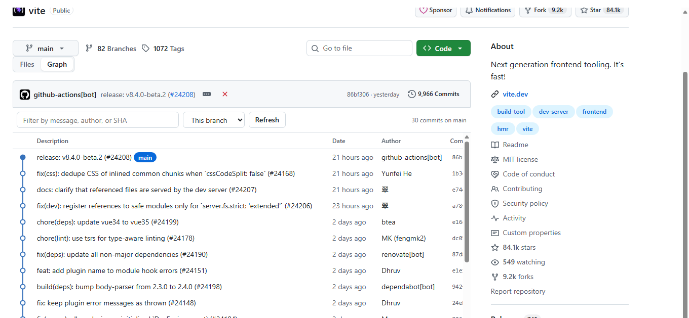
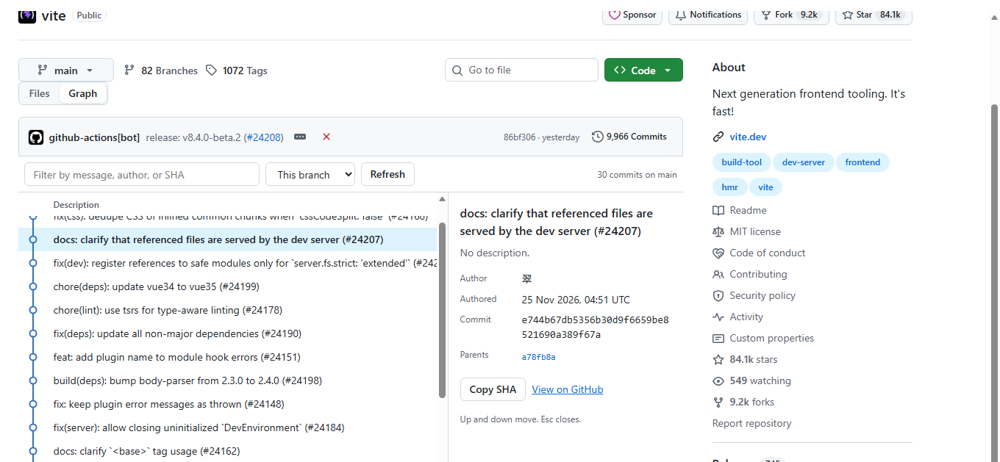
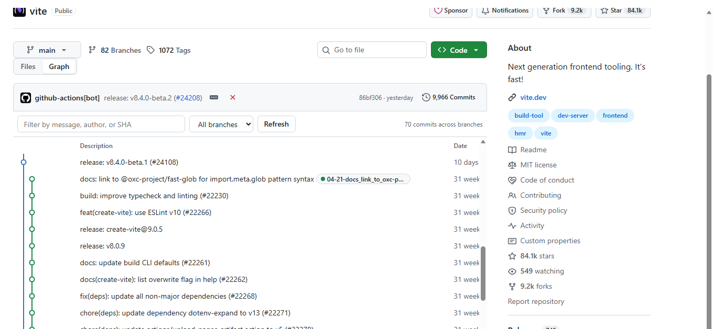

# github-web-graph

Chromium extension that adds a **Files | Graph** control to a GitHub repository Code tab. Graph draws the commits reachable from the selected branch, with lanes for merges, and a read-only commit detail. The file list and About sidebar stay in place when you switch back to Files.

The interaction follows the GALA-155 handoff: the control sits after the branch selector on the repository root and on `/tree/` pages. Tags are not shown.

## Screenshots

Unpacked extension on [vitejs/vite](https://github.com/vitejs/vite).



*Graph on the Code tab. The current branch is a pill, and the About sidebar stays visible.*



*Selecting a row opens the subject, parents, and full SHA.*



*All branches keeps sampled tips from other branches, on their own lanes.*

## Load unpacked

1. Clone this repository.
2. Open `chrome://extensions`.
3. Turn on **Developer mode**.
4. Choose **Load unpacked** and select this directory (the folder that contains `manifest.json`).
5. Open a public repository, for example <https://github.com/octocat/Hello-World>.
6. On the Code tab, choose **Graph**.

The toolbar icon opens the options page. You can also open it from `chrome://extensions` → **Details** → **Extension options**, or from **Extension options** on the rate-limit and private-repository screens.

## Token

Public repositories load with no token. Unauthenticated GitHub REST calls are limited to 60 per hour.

A personal access token is stored in `chrome.storage.local` and sent only to `api.github.com`:

- Fine-grained token: repository **Contents: Read**.
- Classic token: `public_repo` for public repositories, or `repo` for private ones.

Paste the token itself, without a `Bearer` prefix. Reload the GitHub tab after saving.

## What the graph loads

- The selected ref: 30 commits per page. **Load older commits** asks for the next page of that ref.
- Branch names for pills, up to 100 branches.
- Up to 4 other branch tips that are not already in the page, 10 commits each, so **All branches** can show commits that are not on the selected ref.

**This branch** keeps commits reachable from the selected tip, including merge parents. **All branches** shows every commit loaded so far. Search filters the loaded rows in place and does not drop them, so the lanes stay intact.

The view (Files or Graph) is remembered per repository.

## Verify locally

```bash
node --test
```

Then load the unpacked extension and, on a public repository Code tab, check:

- **Graph** shows commits, lanes, and branch pills. Selecting a row opens the subject, parents, and SHA.
- **Copy** puts the full SHA on the clipboard.
- **Files** restores the file list. The About sidebar stays visible in Graph.
- A repository you cannot read shows the private-repository message and an options button.

## Limits

- Injected only on `https://github.com/:owner/:repo` and `https://github.com/:owner/:repo/tree/...`. Blob, blame, commits, issues, and pull requests are left alone.
- Read-only. There is no checkout, revert, or reset.
- Tags are deferred.
- REST does not return a commit total, so the status line uses the loaded count rather than “Showing X of Y”.
- Other branches are a sample, not a full `git log --all`.
- If the branch button is missing, the ref falls back to the remainder of the `/tree/` path, which can include a folder path.

## Future work

- Tag pills.
- A full all-branch walk, and commit totals, when a token is present.
- Remember search and scope per repository.
